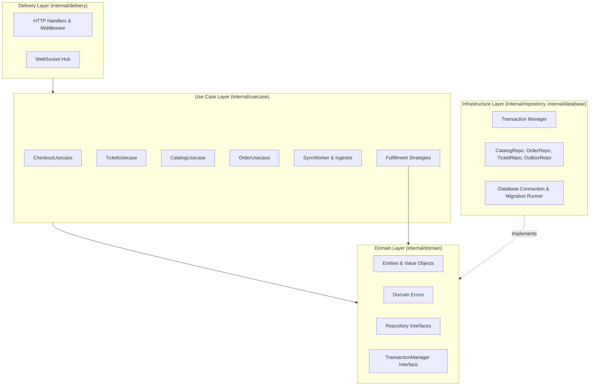

# Clean Architecture & System Design

## Overview

The Headless Multi-Industry POS & Commerce Engine is architected around Robert C. Martin's Clean Architecture principles and Domain-Driven Design (DDD). It supports two runtime targets (`APP_MODE=CLOUD` and `APP_MODE=EDGE`) from a single codebase while preserving strict architectural boundaries and unidirectional dependency flow.

---

## Architectural Layers

### 1. Domain Layer (`internal/domain`)
- Contains enterprise business rules, entities (`Item`, `Order`, `Payment`, `GuestFolio`, `TicketPayload`, `SyncOutbox`), value objects, and domain errors.
- Declares repository interfaces (`CatalogRepository`, `OrderRepository`, `TicketRepository`, `OutboxRepository`) and the `TransactionManager` interface.
- Has zero dependencies on outer layers or external frameworks.

### 2. Use Case Layer (`internal/usecase`)
- Contains application business rules and workflow orchestrations (`CheckoutUsecase`, `TicketUsecase`, `CatalogUsecase`, `OrderUsecase`, `SyncWorker`).
- Depends strictly on interfaces defined in the Domain layer (`domain.TransactionManager`, repository interfaces).
- Never imports infrastructure or delivery packages.

### 3. Delivery Layer (`internal/delivery`)
- Handles presentation mechanisms: REST HTTP routes (Gin) and real-time WebSocket communication.
- Decomposed into modular, single-responsibility handlers (`CatalogHandler`, `CheckoutHandler`, `OrderHandler`, `TicketHandler`, `SyncHandler`, `HealthHandler`).
- Consumes only Use Cases and domain data transfer objects, with no direct access to database repositories or transaction managers.

### 4. Infrastructure Layer (`internal/repository`, `internal/database`)
- Implements persistence contracts defined by the domain layer.
- Handles database connection pooling, SQLite WAL settings, and schema execution.
- Contains the SQL transaction manager and cross-database query rebound functions.

### 5. Composition Root (`cmd/server/main.go`)
- Wires all dependencies together at runtime.
- Initializes configuration, databases, repositories, use cases, handlers, and servers.
- Manages operating system signal trapping and graceful shutdown.

---

## Dual Runtime Modes

| Attribute | `CLOUD` Mode | `EDGE` Mode |
| :--- | :--- | :--- |
| **Role** | Central Hub / Master Data Authority | Local Outlet Store / Turnstile Gateway |
| **Database** | Managed PostgreSQL (TCP) | Local SQLite in WAL mode (`CGO_ENABLED=0`) |
| **Ticketing** | Ed25519 Private Key Signer (Issuer) | 100% Offline Ed25519 Verifier & Turnstile Trigger |
| **Sync Role** | Ingests upstream outbox batches & serves catalog deltas | Outbox pusher & delta catalog puller |
| **Resilience** | Horizontally scalable | 100% offline autonomy; local LAN WebSocket Hub |
