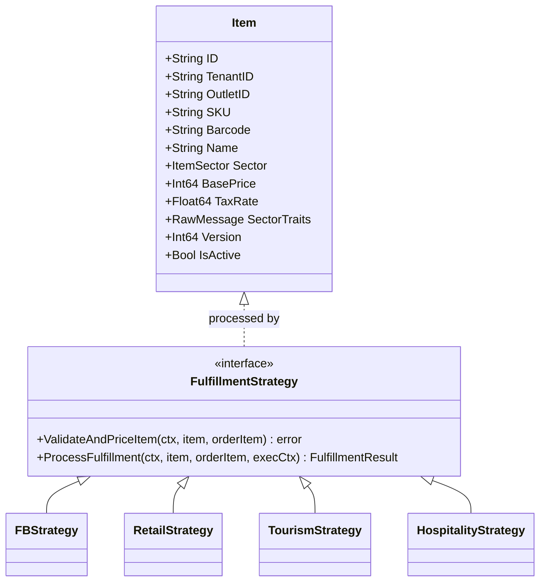

# Domain Models & Sector Fulfillment Strategies

## Polymorphic Catalog Design

The engine models sellable goods across industries using a single table (`items`) coupled with polymorphic JSON traits stored in `sector_traits`.



---

## Sector Traits & Strategies

### 1. Food & Beverage (`SectorFB`)
- **Traits Schema:**
  ```json
  {
    "bom": [
      {"raw_sku": "RAW-BEANS-G", "qty": 18, "uom": "G"},
      {"raw_sku": "RAW-MILK-ML", "qty": 200, "uom": "ML"}
    ],
    "routing_tag": "KITCHEN",
    "modifier_groups": [
      {"name": "Milk Option", "options": [{"name": "Oat Milk", "price_delta": 6000}]}
    ]
  }
  ```
- **Fulfillment Behavior:** Deducts recipe raw ingredients (Bill of Materials) proportionally based on order quantity. Dispatches real-time events to the Kitchen Display System (KDS).

### 2. Retail (`SectorRetail`)
- **Traits Schema:**
  ```json
  {
    "allow_negative_stock": false,
    "conversions": [
      {"uom": "BOX", "factor": 24, "barcode": "899123456002"}
    ],
    "wholesale_tiers": [
      {"min_qty": 10, "unit_price": 68000}
    ]
  }
  ```
- **Fulfillment Behavior:** Handles high-velocity barcode resolution, automatic conversion from packaging units (e.g., BOX to PCS), tiered quantity pricing, and batch/expiry validation.

### 3. Tourism (`SectorTourism`)
- **Traits Schema:**
  ```json
  {
    "pass_type": "VIP",
    "pax_per_ticket": 1,
    "validity_hours": 24,
    "requires_gate_pass": true
  }
  ```
- **Fulfillment Behavior:** Validates date and quota bounds. Integrates with the Ed25519 offline cryptographic ticketing module.

### 4. Hospitality (`SectorHospitality`)
- **Traits Schema:**
  ```json
  {
    "facility_type": "DELUXE_ROOM",
    "housekeeping_status": "CLEAN",
    "allow_folio_charge": true
  }
  ```
- **Fulfillment Behavior:** Manages duration-bound bookings, housekeeping statuses (`CLEAN`, `INSPECTED`, `DIRTY`), and room folio charge integrations allowing guests to charge retail or cafe orders to their room bill.

---

## Transactional Outbox & Sync Guarantees

In Edge mode, all state changes (orders, payments, stock movements, and ticket redemptions) are written within an atomic local SQLite transaction alongside an outbox record in `sync_outbox`.

The background `SyncWorker` transmits outbox records to Cloud. Under the **Physical Reality Wins** principle:
- Cloud never rejects paid offline transactions due to negative stock.
- The transaction is accepted, negative stock is recorded, and an inventory alert is dispatched for administrative reconciliation.
